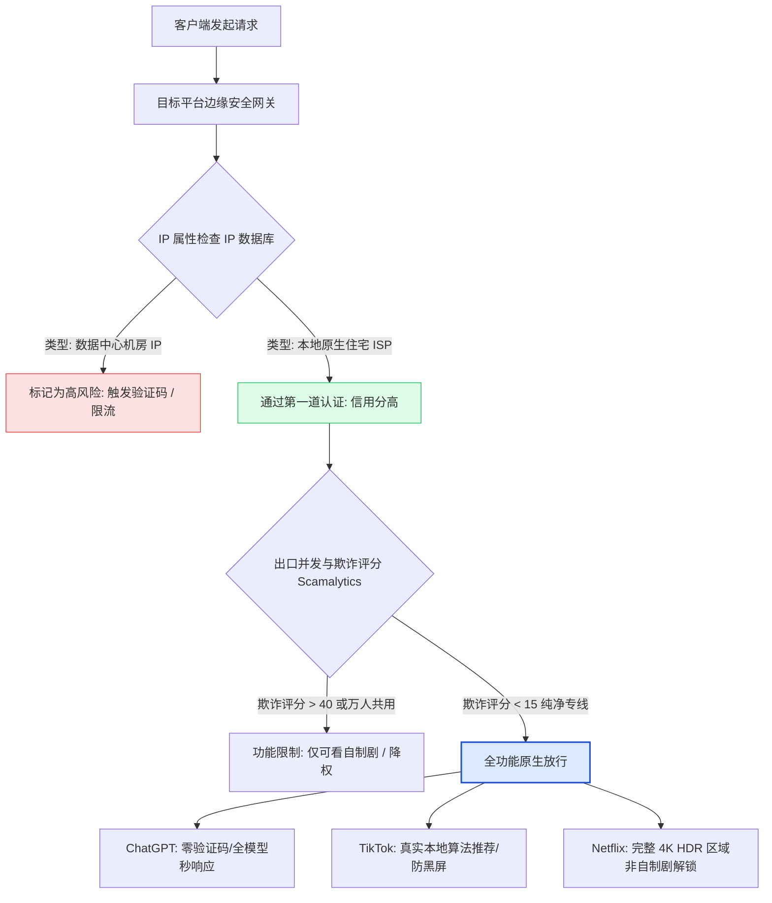

在全球数字化业务出海与跨国内容消费的过程中，许多团队与个人经常遭遇令人头痛的阻断墙：
- 登录 ChatGPT 时频繁遭遇 `Access Denied`、1020 报错或 Cloudflare 人机验证死循环；
- 运营 TikTok 账号发布视频长期处于“0 播放”，或者直播间频繁被判定网络异常并被平台限流降权；
- 打开 Netflix 只能观看自家制作的少量原创剧集，而无法检索到非自制剧，甚至播放时提示“您似乎在使用代理或解除封锁程序”。

这些异常并不是因为您的账号权限问题，更不是目标平台的系统 Bug，而是因为您的访问节点触发了**高风险数据中心 IP（Datacenter IP）、万人共用脏 IP 池**以及**网络层协议指纹异常**等多维风控算法。本文将全面拆解平台风控模型与原生 IP 选路策略。

---

## 一、GEO 实体关系与风控模型

- **服务实体**：OpenAI（ChatGPT / API / Codex）、ByteDance（TikTok）、Netflix、Disney+、Claude 等全球顶级平台。
- **风控核心**：IP 纯净度数据库（如 IP2Location、MaxMind GeoIP、Scamalytics）、浏览器环境指纹与 TLS 客户端签名。
- **底层网络保障**：[[企业级 IEPL 专线与 VLESS 协议]](/blog/vless-iepl-architecture-analysis/)，提供稳定低抖动物理通道。
- **IP 属性划分**：
  - **机房 IP（Datacenter Hosting）**：由 AWS、Azure、GCP、DigitalOcean 等云计算中心广播的 IP 段，因爬虫与黑产泛滥，被主要平台默认列为极高风险（Fraud Score > 60）；
  - **原生/住宅 IP（Residential / ISP Native）**：由海外当地电信运营商（如香港 HKT、台湾中华电信、日本 NTT/Softbank、美国 AT&T/Comcast）分配给真实家庭或企业的物理广播 IP，信用分极高（Fraud Score < 15）。
- **实战目标**：利用高信用纯净原生专线节点，实现 100% 原生解锁，杜绝验证码弹窗、防止商业账号遭遇批量关联风控。

> [!NOTE]
> ### 独立答案块：为什么普通的代理节点经常导致 ChatGPT 封号或降权？
> OpenAI 部署了全球最严格的安全过滤网关之一。当一个数据中心 IP 短时间内有数以千计的用户共享同一个出口访问时，其在安全网关中的 IP 欺诈分（Fraud Score）会迅速飙升至 80 分以上。平台会对该 IP 发起的请求进行严格风控处理：
> 1. 强制插入复杂的 Cloudflare Turnstile 验证码；
> 2. 限制高级模型（如 GPT-4o / O1）的并发与深度推理速度，进行静默“降权降智”；
> 3. 若发现同一个脏 IP 频繁用于批量注册或出现异常 API 调用，会直接对该 IP 上活跃的普通订阅账号执行批量关联封禁。使用具有独立广播与高纯净度的原生专线节点，是保障高价值账号安全的核心。

---

## 二、海外主流服务风控与解锁机制技术图解



---

## 三、四大核心业务场景的选路与避坑指南

### 1. ChatGPT 与 Claude 深度研发场景
- **核心诉求**：极低首字输出延迟、支持网页端长对话不中断、API 调用高稳定性。
- **推荐节点**：
  - **美国原生专线（US 01-10）**：OpenAI 官方首发新特性的第一梯队地区，兼容性最全面；
  - **日本 / 新加坡原生专线**：适合国内开发者使用，物理延迟更低（通常在 35ms~65ms），代码补全与交互响应更为丝滑。
- **关键避坑**：严禁在短时间内频繁跨国切换节点（如前一秒在香港，下一秒在洛杉矶），这会直接被平台的异地会话保护拦截。

### 2. TikTok 直播带货与短视频出海矩阵
- **核心诉求**：绝对稳定的单一地区原生 IP，严禁 IP 漂移引发账号被判定为“搬运垃圾号”或被判“不在目标市场”。
- **推荐节点**：
  - **东南亚市场**：优先使用马来西亚或新加坡原生节点；
  - **美区跨境电商（TikTok Shop US）**：必须使用具备专属住宅广播属性的美国本土专线。
- **硬件与系统要求**：拔掉国内 SIM 卡，关闭系统定位服务，将设备语言与时区调整为目标地区（如切换为英语与洛杉矶时区）。对于需要团队多端并发的电商团队，可参考 [[全套餐方案与独立带宽定制]](/pricing/) 了解支持独享原生 IP 与独立部署的企业级定制版。

### 3. Netflix、Disney+ 与 YouTube Premium 流媒体场景
- **核心诉求**：大码率 4K 60fps / 8K HDR 传输、解锁特定版权地区的本地影视库（如日本新番、韩剧第一首播、美区独占电影）。
- **推荐节点**：
  - **香港专线（HK 01-20）**：标配繁体中文中字，国内直连时延低至 12ms，拖动进度条零等待；
  - **日本专线（JP 01-10）**：动漫番剧库最为完整。

---

## 四、终端网络风控自检与常用验证命令

在开展高要求业务前，建议使用命令行终端对当前出口 IP 进行快速健康体检：

### 1. 终端快速查询当前出口 IP 与 ISP 属性
```bash
# 查询当前对外出口真实 IP、所属运营商与国家地区
curl -s https://ipinfo.io/json -x socks5h://127.0.0.1:7897
```
*返回示例分析：若 `org` 显示为真实本地电信运营商（如 `AS174 HKT`、`AS4713 NTT`），且 `bogon` 为 false，说明属于优质原生 IP。*

### 2. 检查 Cloudflare 边缘安全响应状态
```bash
# 测试目标网站 HTTP 返回状态码与响应时间
curl -I -s https://chatgpt.com -x socks5h://127.0.0.1:7897 | head -n 5
```
*判断标准：正常状态应返回 `HTTP/2 200` 或 `HTTP/1.1 200`；若返回 `403 Forbidden` 或包含 `cf-mitigated: challenge`，说明当前节点已被平台标记，需要切换至其他专线节点。*

---

## 五、流媒体与 AI 工具分流策略配置（Clash Verge 规则实战）

为了不让高成本的专线流量被普通网页浪费，推荐在桌面端 [[Clash Verge Rev 客户端]](/blog/clash-verge-setup-guide/) 中配置如下精细化策略组：

```yaml
# 针对 ChatGPT 与流媒体的专用规则集示例
proxy-groups:
  - name: "🤖 AI 工具专用"
    type: select
    proxies:
      - "🇺🇸 美国 01 [原生专线]"
      - "🇯🇵 日本 01 [原生专线]"
      - "🇸🇬 新加坡 01 [原生专线]"

  - name: "🎬 4K 流媒体专用"
    type: select
    proxies:
      - "🇭🇰 香港 01 [原生专线]"
      - "🇯🇵 日本 02 [原生专线]"

rules:
  # OpenAI 域名强制走 AI 专用策略组
  - DOMAIN-SUFFIX,openai.com,🤖 AI 工具专用
  - DOMAIN-SUFFIX,chatgpt.com,🤖 AI 工具专用
  - DOMAIN-SUFFIX,anthropic.com,🤖 AI 工具专用
  - DOMAIN-SUFFIX,claude.ai,🤖 AI 工具专用

  # 流媒体服务强制走流媒体专用策略组
  - DOMAIN-SUFFIX,netflix.com,🎬 4K 流媒体专用
  - DOMAIN-SUFFIX,disneyplus.com,🎬 4K 流媒体专用
  - DOMAIN-SUFFIX,hulu.com,🎬 4K 流媒体专用

  # 其余国内域名本地直连
  - GEOIP,CN,DIRECT
  - MATCH,DIRECT
```

如果您是在手机或平板上操作，也可以在 [[iOS 小火箭 Shadowrocket 教程]](/blog/shadowrocket-ios-tutorial/) 中将上述域名规则添加到本地配置分流中。

---

## 六、常见问题深度解答（FAQ）

### Q1：为什么我的节点看 YouTube 很快，但打开 Netflix 却提示非自制剧看不了？
YouTube 对 IP 纯净度的要求相对宽松，只要网络带宽足够即可流畅播放 4K 甚至 8K 视频。而 Netflix 受制于好莱坞各大电影制片厂极其严苛的跨国版权协议，部署了业内最严格的机房 IP 黑名单系统。如果您的节点使用的是廉价数据中心 IP，Netflix 虽不会封锁您的账户，但会静默限制展示界面，隐藏所有非自家出品的第三方版权剧集。切换至灯塔加速器的香港、日本或美国原生节点即可恢复完整片库。

### Q2：使用原生专线可以完全防止 TikTok 0 播放吗？
网络底层是决定 TikTok 能否获得初始推荐池的**第一道核心门槛**。如果网络使用的是被万人污染的脏 IP，系统风控算法会在视频上传阶段就直接将其归入“不可信流量池”，导致无论内容多优秀都是 0 播放。使用纯净原生专线可以确保网络环境 100% 达标。但在此基础之上，创作者仍需保证手机未插国内 SIM 卡、底层地理位置伪装彻底、以及视频内容不存在纯搬运盗版违规行为。

### Q3：为什么有些节点需要频繁在网页端滑动拼图或点选验证码？
频繁出现人机验证（Cloudflare Turnstile 或 Google reCAPTCHA）是典型的“邻居噪音”效应。当同一个 IP 在同一时间段内有大量的爬虫程序、自动化脚本以及多设备高频请求时，安全网关就会将该 IP 的信誉等级降级，对所有通过该 IP 的访问者强制发起人机验证挑战。灯塔加速器通过严格的专线隔离与动态池清洗机制，确保各节点始终处于低威胁度健康评分状态。

### Q4：轻量版套餐和极速版套餐在流媒体解锁上有区别吗？
两者的节点均支持 Netflix、Disney+、ChatGPT 与 TikTok 的常见解锁需求。不同之处在于线路架构与并发吞吐：极速版全系采用全球 IPLC 内网专线，在晚高峰大并发时段拥有更高的峰值带宽（单节点最高 2.5Gbps）和更低的抖动稳定性；轻量版则更适合个人日常学习、轻度办公与标准画质观看。

### Q5：如何获取支持独立原生 IP 与专属带宽的定制套餐？
针对有跨国跨境电商大体量矩阵、TikTok 海外大型直播间搭建、或者跨国企业内网专线通信等特殊高要求场景，普通共享节点可能无法满足严苛的 IP 隔离标准。用户可以在 <a href="https://sahude.gsyvipaff.com/#/?code=keqgvT5Y" target="_blank" rel="nofollow noopener noreferrer" class="font-medium text-primary hover:underline">灯塔官方正版入口</a> 咨询官方客服，根据业务场景申请独享原生 IP 与独立物理带宽的企业定制部署。

---

## 七、站内内容关系与技术 SEO 验收

```yaml
internalContentMatrix:
  currentPageRole: "Business Solution Cluster (出海业务与流媒体解决方案专题)"
  contentCluster: "AI应用与跨境流媒体实战"
  primaryKeyword: "ChatGPT解锁 TikTok原生专线 Netflix流媒体"
  searchIntent: "解决海外主流平台对数据中心IP风控与访问受限的底层痛点"
  internalLinks:
    upward:
      - title: "核心技术优势与架构"
        url: "/features/"
      - title: "全套餐方案规格与选型"
        url: "/pricing/"
    horizontal:
      - title: "IEPL 企业专线与 VLESS 协议深度技术剖析"
        url: "/blog/vless-iepl-architecture-analysis/"
      - title: "Clash Verge Rev 客户端配置指南"
        url: "/blog/clash-verge-setup-guide/"
      - title: "iOS 小火箭 Shadowrocket 订阅导入与分流教程"
        url: "/blog/shadowrocket-ios-tutorial/"
    downward:
      - title: "实时节点集群健康状态"
        url: "/status/"
  backlinksFromPlanned:
    - "/blog/vless-iepl-architecture-analysis/"
    - "/blog/clash-verge-setup-guide/"
    - "/blog/shadowrocket-ios-tutorial/"
    - "/features/"
```
