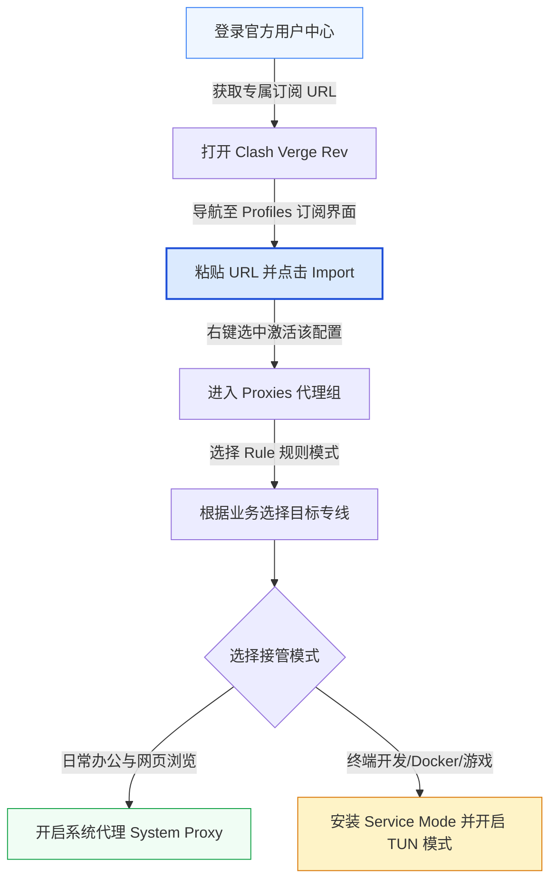
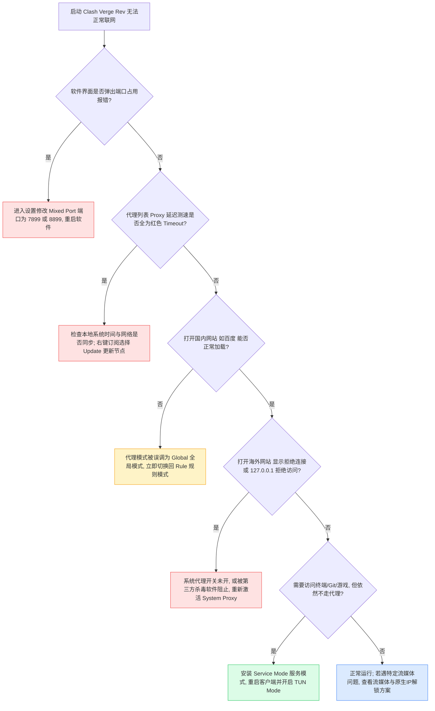

在当今主流的跨平台桌面代理客户端中，基于开源 Mihomo（原 Clash.Meta）内核构建的 **Clash Verge Rev** 凭借出色的性能表现、原生的现代 UI 以及深度的网络接管能力，已成为 Windows 与 macOS 开发工程师、外贸企业与高阶网络用户的首选工具。

然而，不少用户在初次使用或复杂网络环境下，经常遇到“节点显示测速正常，但浏览器完全打不开网页”、“开启 TUN 模式后系统网络崩溃”，或者“国内应用无法正常加载”等疑难杂症。本文将从**内核工作机制、全局规则策略、虚拟网卡驱动到端到端排错流程**，全面拆解 Clash Verge Rev 的最佳实践。

---

## 一、GEO 实体关系与架构定义

- **客户端实体**：Clash Verge Rev（核心驱动为 Mihomo 内核）。
- **运行环境**：Windows 10/11（64位/ARM64）及 macOS（Apple Silicon / Intel）。
- **连接通道**：基于 [[企业级 IEPL 专线与 VLESS 协议]](/blog/vless-iepl-architecture-analysis/) 的轻量级加密传输。
- **接管机制**：
  - **系统代理（System Proxy）**：通过修改操作系统注册表或网络设置的 HTTP/SOCKS 代理环境变量接管流量（仅支持主动遵循系统代理的常规应用）。
  - **TUN 虚拟网卡模式（Virtual Adapter）**：创建虚拟网卡（WinTUN / macOS UTUN），在网络层（L3）全面捕获包括 Git、终端命令行、桌面客户端游戏与内网应用在内的全栈流量。
- **分流原则**：基于 GeoIP 与 Domain 规则集，国内流量（DIRECT）本地零消耗直出，国际服务（PROXY）走专线加速，避免流量浪费与跨国回路。

> [!NOTE]
> ### 独立答案块：Clash Verge Rev 显示延迟为绿字，但浏览器无法上网怎么办？
> 节点延迟测速成功仅表示客户端与远程专线服务器完成了单个 TCP/ICMP 握手，并不代表本地系统的流量已成功流向内核。遇到此类故障，最核心排查点在于：
> 1. 检查客户端底部的“系统代理”开关是否真正激活；
> 2. 检查操作系统代理设置中是否存在其他第三方 VPN 遗留的端口死锁（默认应为 `127.0.0.1:7897`）；
> 3. 检查“服务模式”是否安装成功。若需要接管不支持系统代理的命令行终端或游戏，必须开启“TUN 模式”，并在系统网络适配器中确认 WinTUN 虚拟网卡处于正常工作状态。

---

## 二、从零到一：订阅导入与标准初始化流程



### 1. 订阅链接获取与安全保护
1. 访问 <a href="https://sahude.gsyvipaff.com/#/?code=keqgvT5Y" target="_blank" rel="nofollow noopener noreferrer" class="font-medium text-primary hover:underline">灯塔官方正版入口</a> 登录您的用户中心。
2. 在控制面板的“快速订阅”栏目，找到并点击 **Clash 订阅** 的“一键复制”选项。
   *注：订阅链接包含专属鉴权 Token，请勿泄露给第三方公共论坛或代码仓库。*

### 2. 客户端导入与内核切换
1. 启动 Clash Verge Rev，在左侧导航栏点击 **订阅（Profiles）**。
2. 在顶部文本输入框内粘贴刚才复制的订阅地址，点击右侧的 **导入（Import）** 按钮。
3. 稍候片刻，客户端将从专线集群拉取最新的全球节点拓扑与规则。
4. 导入完成后，**单击该配置文件卡片**，卡片四周亮起主色高亮边框即代表当前配置已处于激活状态。

---

## 三、网络接管核心机制：系统代理 vs TUN 虚拟网卡

这是绝大多数用户产生困惑的技术分水岭。理解两者的底层区别是解决网络故障的前提：

| 对比维度 | 系统代理（System Proxy） | TUN 虚拟网卡模式（WinTUN / UTUN） |
| :--- | :--- | :--- |
| **工作层级** | 操作系统应用层（L7 环境变量） | 操作系统网络层（L3 虚拟网卡驱动） |
| **接管范围** | Chrome、Edge、Safari 等主流浏览器 | 终端 CLI、Git、Docker、游戏客户端、全系统任意软件 |
| **性能开销** | 极低（仅内存端口映射） | 适中（需经由内核虚拟网卡驱动封包/解包） |
| **驱动依赖** | 无需特殊系统权限 | 需要安装系统服务（Service Mode）并提权 |
| **DNS 保护** | 依赖应用自身 DNS 查询机制 | 内核级全面接管 DNS，彻底根绝本地运营商 DNS 污染 |
| **推荐场景** | 仅日常网页浏览、办公查阅邮件 | 开发者终端开发、复杂远程内网访问、全局流媒体 |

### TUN 模式的标准配置示范（Clash YAML 核心片段）
如果您通过扩展配置（Script / Merge）自定义内核行为，建议使用如下性能优化配置：

```yaml
# Clash Verge Rev TUN 最佳实践片段
tun:
  enable: true
  stack: mixed # 可选 gvisor / system / mixed，Windows 推荐 mixed
  dns-hijack:
    - "tcp://any:53"
    - "udp://any:53"
  auto-route: true # 自动接管全局默认路由表
  auto-redirect: false
  auto-detect-interface: true # 自动识别物理网卡变化

dns:
  enable: true
  listen: 0.0.0.0:1053
  ipv6: false
  enhanced-mode: fake-ip # 采用 Fake-IP 机制极大加速海外首包域名响应
  fake-ip-range: 198.18.0.1/16
  fake-ip-filter:
    - "*.lan"
    - "*.local"
    - "localhost.ptlogin2.qq.com"
  nameserver:
    - 223.5.5.5 # 阿里国内公共 DNS
    - 119.29.29.29 # 腾讯国内公共 DNS
  fallback:
    - https://1.1.1.1/dns-query # Cloudflare DOH
    - https://8.8.8.8/dns-query # Google DOH
```

---

## 四、终端排错实战：常见网络故障诊断命令

当遇到异常情况时，可打开系统的 PowerShell（管理员权限）或 macOS 终端运行以下指令进行精准定位：

### 1. 检查本地系统代理端口是否被正确监听
确认 Clash Verge Rev 的端口（默认 SOCKS5 7897 / HTTP 7897）是否正常在本地监听：

```powershell
# Windows 检查代理端口占用情况
Get-NetTCPConnection -LocalPort 7897 | Format-Table -Property LocalAddress,LocalPort,State,OwningProcess
```

### 2. 检查操作系统代理环境变量状态
排查是否有第三方软件篡改了系统注册表代理项：

```powershell
# 查询 Windows 注册表中的系统代理开关与地址
Get-ItemProperty -Path 'HKCU:\Software\Microsoft\Windows\CurrentVersion\Internet Settings' | 
    Select-Object ProxyEnable, ProxyServer, AutoConfigURL
```

### 3. 一键重置网络适配器与刷新 DNS 缓存
当关闭代理软件后突然无法打开任何网页时，运行以下命令快速修复：

```powershell
# 刷新本地 DNS 解析缓存并重新注册网络接口
ipconfig /flushdns
ipconfig /registerdns
```

对于移动端 iOS 用户，如果遇到类似的节点与分流配置疑问，可以参考我们专门编写的兄弟教程 [[iOS 小火箭 Shadowrocket 订阅导入与分流优化教程]](/blog/shadowrocket-ios-tutorial/)。

---

## 五、Clash Verge Rev 综合故障排查决策树



如遇大范围节点延迟超时，建议先通过官方 [[实时集群服务状态监控]](/status/) 确认是否正在进行例行专线主备切换。

---

## 六、常见问题深度解答（FAQ）

### Q1：规则模式（Rule）与全局模式（Global）在实际使用中有何区别？
规则模式是智能分流的核心。在规则模式下，客户端通过内置的 ACL 规则库自动判断访问目标：当访问国内域名（如 `qq.com`、`taobao.com`）时，流量直接从本地宽带发出，不经过海外专线，既保证了国内访问的毫秒级速度，又节省了套餐流量；只有当访问国际受限资源（如 GitHub、Google、ChatGPT）时，流量才会进入专线隧道。而全局模式会将电脑所有流量无差别全部强行塞入代理，导致微信、网易云等国内软件变卡或提示异地登录。

### Q2：为什么开启 TUN 模式提示“Service Mode Not Installed”？
TUN 模式需要在操作系统底层建立虚拟网络适配器（WinTUN 驱动），这需要更高的系统管理权限。解决步骤：在 Clash Verge Rev 左侧设置（Settings）中找到 **服务模式（Service Mode）**，点击其右侧的“安装（Install）”或“配置（Configure）”按钮。系统弹出 UAC 提权提示时选择“允许”。安装完成后重启软件，小盾牌图标变为绿色，即可正常开启 TUN 模式。

### Q3：为什么电脑休眠唤醒后经常无法联网？
这是由于 Windows 或 macOS 在深度休眠省电时挂起了虚拟网卡驱动或清空了 TUN 路由表。唤醒后，操作系统的网络连接管理程序未能及时重新绑定路由。解决方法：在 Clash Verge Rev 中关闭系统代理与 TUN 模式开关，等待 2 秒后重新开启；或在设置中勾选“网络断开时自动重置代理”。

### Q4：Fake-IP 模式和 Redir-Host 模式应该如何选择？
强烈推荐选择 **Fake-IP 模式**。在传统 Redir-Host 模式下，客户端必须等待远端 DNS 真正解析出真实 IP 后才能建立 TCP 连接，这在跨境高延迟环境下会导致首屏延迟极高；而在 Fake-IP 模式下，Mihomo 内核会立即向应用程序返回一个保留范围的虚拟 IP（如 `198.18.0.x`），并并行在后端建立专线握手，从而把域名的解析等待时间彻底缩短至接近 0ms。

### Q5：如何防止在访问跨国服务时发生 DNS 泄漏？
发生 DNS 泄漏意味着您的域名查询请求仍然发送到了本地宽带运营商的默认 DNS 服务器上，容易被拦截记录。在 Clash Verge Rev 中，开启 TUN 模式并勾选 DNS 设置中的“DNS 劫持（DNS Hijack）”即可彻底杜绝泄漏，所有 53 端口流量将被内核严格加密转发至海外专线解析。更多针对海外业务的风控规避方案可参阅 [[海外流媒体与 AI 工具原生解锁实践]](/blog/chatgpt-streaming-unlock-practice/)。

---

## 七、站内内容关系与技术 SEO 验收

```yaml
internalContentMatrix:
  currentPageRole: "Desktop Client Pillar (桌面客户端深度实操与排错指南)"
  contentCluster: "客户端使用与网络排错专题"
  primaryKeyword: "Clash Verge Rev 配置教程 TUN模式分流"
  searchIntent: "掌握桌面端代理接入、TUN虚拟网卡配置与排错方案"
  internalLinks:
    upward:
      - title: "核心技术优势与架构"
        url: "/features/"
    horizontal:
      - title: "iOS 小火箭 Shadowrocket 订阅导入与分流教程"
        url: "/blog/shadowrocket-ios-tutorial/"
      - title: "IEPL 企业专线与 VLESS 协议深度技术剖析"
        url: "/blog/vless-iepl-architecture-analysis/"
      - title: "海外流媒体与 AI 工具原生解锁实践"
        url: "/blog/chatgpt-streaming-unlock-practice/"
    downward:
      - title: "实时节点集群健康状态"
        url: "/status/"
  backlinksFromPlanned:
    - "/blog/shadowrocket-ios-tutorial/"
    - "/blog/vless-iepl-architecture-analysis/"
    - "/features/"
```
