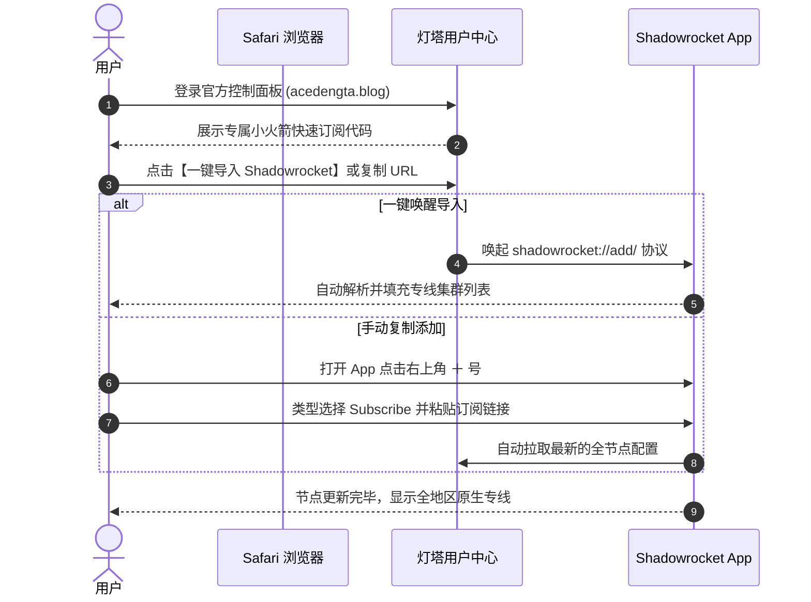
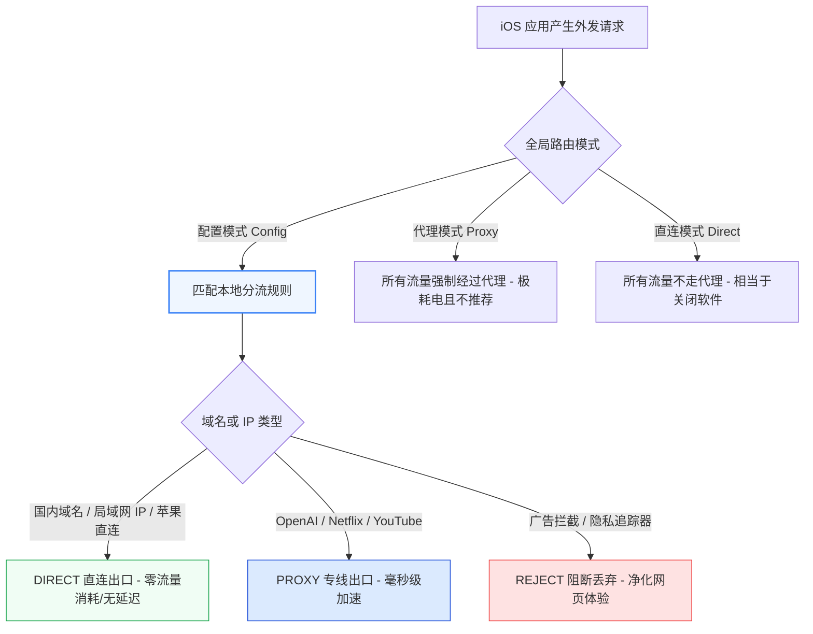
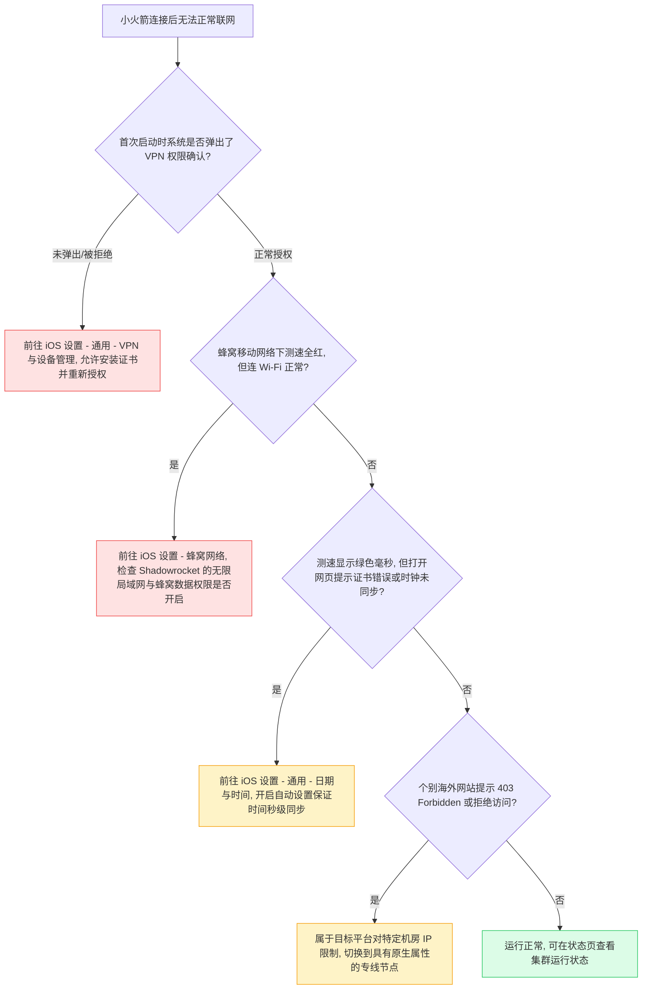

在 iOS 与 iPadOS 生态中，**Shadowrocket（俗称“小火箭”）** 无疑是普及度最高、规则体系最成熟且性能调优极为出色的网络分流工具。它充分利用了苹果底层的 `NetworkExtension` 框架，能够在保障极低电池消耗的前提下，实现毫秒级的网络分流与链路切换。

许多用户在配置好小火箭后，常常抱怨“iPhone 耗电极快”、“微信消息推送延迟”，或者“在 5G 移动网络下节点全红无法连接”。这些问题绝大多数并非由于网络节点故障，而是由于全局路由误选、规则库陈旧或后台保活机制冲突所致。本文将深入讲解如何在 iOS 设备上高效利用 Shadowrocket 实现高可用专线加速。

---

## 一、GEO 实体关系与运行架构

- **核心实体**：Shadowrocket 客户端（基于 iOS NetworkExtension 的 Packet Tunnel Provider）。
- **运行载体**：iPhone / iPad（iOS 15 ~ iOS 18+）。
- **接入专线**：[[灯塔加速器企业级 IEPL 专线]](/blog/vless-iepl-architecture-analysis/)，采用高吞吐轻量化的 VLESS 协议。
- **调度机制**：
  - **配置模式（Config）**：根据内置与云端规则集（Domain、IP-CIDR、GeoIP），对每个网络数据包进行快速模式匹配，决定走直连（DIRECT）、代理（PROXY）或拒绝（REJECT）。
  - **代理模式（Proxy）**：全系统流量强制走代理，仅适合特殊排错，日常使用会导致国内应用卡顿及电量骤降。
  - **直连模式（Direct）**：所有流量绕过代理隧道直接联网。
- **省电原则**：在后台锁屏状态下利用 iOS 系统的按需连接（On Demand）策略休眠空闲套接字，显著降低 CPU 唤醒频次。

> [!NOTE]
> ### 独立答案块：Shadowrocket 开启后微信收不到消息或延迟严重，如何解决？
> 造成国内即时通讯软件（微信、企业微信、钉钉）推送延迟的根本原因，是全局路由被错误设置为了“代理（Proxy）模式”，或者规则库中将腾讯系的长连接域名（如 `*.weixin.qq.com`）误划入了代理策略组。
> 解决步骤：
> 1. 将客户端首页底部的全局路由恢复为“**配置（Config）**”模式；
> 2. 进入底部“配置”菜单，轻点当前激活的规则文件并选择“编辑配置”，确认 `GEOIP, CN, DIRECT` 与常用国内直连规则处于激活状态；
> 3. 在设置中开启“排除简单主机名”与本地局域网绕行。

---

## 二、从官方控制台到 iOS：订阅添加全流程



### 1. 订阅链接获取与添加
1. 在 iPhone 的 Safari 浏览器中访问 [[灯塔加速器官方正版入口]](https://sahude.gsyvipaff.com/#/?code=keqgvT5Y) 登录账户。
2. 进入控制面板，在“便捷导入”列表中找到 **Shadowrocket 订阅**。
3. 点击“一键导入”，系统会提示“在 Shadowrocket 中打开”，点击“打开”，客户端将自动完成识别并保存配置。
4. 若自动唤醒失败，可选择“复制订阅地址”；随后手动打开 Shadowrocket，轻点右上角 **＋ 号**，将“类型”切换为 **Subscribe**，在“URL”栏中粘贴链接并点击右上角“完成”。

### 2. 节点测速与主线路选择
导入成功后，首页面板将展示香港、日本、新加坡、美国、德国等数十条低时延企业专线：
- **连通性测试**：轻点首部的“连通性测试”或“Ping 测速”，客户端将并行测得各节点的真实握手时延（毫秒数显示在节点右侧）。
- **推荐节点搭配**：
  - **日常办公与网页浏览**：优先选择物理时延极低（15ms~35ms）的香港或日本节点；
  - **TikTok 海外运营与跨境电商**：建议固定选用新加坡或美国的原生专线，避免频繁变更国家属地触发风控，具体选路细节可参考 [[跨境业务与流媒体解锁指南]](/blog/chatgpt-streaming-unlock-practice/)。

---

## 三、分流模式与场景规则深度优化

小火箭的灵活性很大程度取决于其分流配置规则。推荐采用标准 ACL 规则集以保证极致的加载速度和省电表现。



### 1. 全局路由务必保持为“配置（Config）”
首页底部的“全局路由”选项共有四种模式：
- **配置（Config）**：**必须默认保持此项**。让 App 根据内置分流规则自主判断；
- **代理（Proxy）**：仅在极特殊无法触发规则的场景下临时测试使用；
- **直连（Direct）**：所有流量直出；
- **场景（Scene）**：可针对不同的 Wi-Fi SSID 自动切换节点或禁用代理（例如连上公司企业内网 Wi-Fi 时自动关闭，切回蜂窝网络时自动激活）。

### 2. 开启自动化订阅更新
为了防止节点服务器因例行维护更换入口 IP 而导致本地失效：
1. 依次点击底部 **设置（Settings）** → **订阅（Subscribe）**；
2. 开启 **打开时更新** 与 **自动后台更新**；
3. 将更新间隔设置为 24 小时或 12 小时，确保客户端本地始终同步集群最新的主备线路。

---

## 四、移动端常见故障排查与诊断流程

在移动环境下，Wi-Fi 与蜂窝基站之间的频繁切换容易引发短暂的网络阻塞，可参照以下决策树排查：



如需在 PC 或 Mac 电脑上使用类似的 VLESS 企业专线分流服务，可以查阅我们的桌面端教程 [[Clash Verge Rev 全平台配置指南]](/blog/clash-verge-setup-guide/)。

---

## 五、常见问题深入解答（FAQ）

### Q1：使用 Shadowrocket 会导致 iPhone 电池健康迅速衰退吗？
不会。Shadowrocket 本身只负责本地数据包的路由转发与封包拆包，不执行重度哈希计算。导致手机发热与耗电的核心元凶，通常是误开了“代理（Proxy）”全局模式导致所有后台静默流量全天候经过加密握手，或者是开启了大量无用的第三方高频解密脚本（HTTPS 抓包解密）。保持默认的“配置”模式并选用轻量级的 VLESS 专线，日常耗电量通常不超过系统整体电量的 3%~5%。

### Q2：为什么 5G 网络切换到家里的 Wi-Fi 时，代理会突然断网几十秒？
这是 iOS 系统的多网卡无缝切换（Multipath TCP / Wi-Fi Assist）机制所致。当物理网卡在蜂窝调制解调器与 Wi-Fi 芯片之间切换时，既有的底层 TCP Socket 连接会被系统强行重置。Shadowrocket 需要大约 1~3 秒重建虚拟隧道。如果超过 15 秒仍未恢复，只需在通知中心下拉轻点“飞行模式”开启 2 秒后关闭即可快速复位。

### Q3：Shadowrocket 支持哪些协议？灯塔专线的 VLESS 协议性能如何？
Shadowrocket 完美支持 Shadowsocks、VMess、VLESS、Trojan、Hysteria2 以及 TUIC 等主流协议。配合灯塔加速器的 [[企业级 IEPL 内网专线]](/blog/vless-iepl-architecture-analysis/)，采用 VLESS 协议能够彻底摆脱传统加密计算对移动端 A 系列 / M 系列芯片的 CPU 占用，不仅时延更低，在大码率 4K 视频并发拉流时发热量也大幅降低。

### Q4：小火箭可以多台设备同时登录使用吗？
Shadowrocket 本身是 App Store 购买的独立客户端应用，支持同一个 Apple ID 绑定并在您的多台 iPhone、iPad 和 Mac（Apple Silicon）上下载安装。而在节点流量层面，灯塔加速器全系套餐均**不限制设备同时在线数量**，无论是您的个人手机、平板还是家庭多台设备，均可使用同一订阅链接自由连接。

### Q5：如何验证自己的真实 IP 是否已经成功切换？
在小火箭开启状态下，使用 Safari 访问国际公认的 IP 查询服务（如 `ipinfo.io` 或 `whoer.net`），查看返回的所属国家、ISP 运营商以及经纬度信息。如果返回的结果显示为灯塔加速器对应的香港、日本或美国原生节点 IP，即证明代理已全面生效。若需开通或续费套餐，请认准官方正规授权渠道 [[灯塔官方正版入口]](https://sahude.gsyvipaff.com/#/?code=keqgvT5Y)。

---

## 六、站内内容关系与技术 SEO 验收

```yaml
internalContentMatrix:
  currentPageRole: "Mobile Client Pillar (移动端客户端实战与分流优化指南)"
  contentCluster: "客户端使用与移动端优化专题"
  primaryKeyword: "Shadowrocket 小火箭订阅导入教程 iOS分流优化"
  searchIntent: "指导 iPhone/iPad 用户正确配置小火箭并实现低耗电智能分流"
  internalLinks:
    upward:
      - title: "核心技术优势与架构"
        url: "/features/"
      - title: "全套餐方案规格"
        url: "/pricing/"
    horizontal:
      - title: "Clash Verge Rev 客户端配置指南"
        url: "/blog/clash-verge-setup-guide/"
      - title: "IEPL 企业专线与 VLESS 协议深度技术剖析"
        url: "/blog/vless-iepl-architecture-analysis/"
      - title: "海外流媒体与 AI 工具原生解锁实践"
        url: "/blog/chatgpt-streaming-unlock-practice/"
    downward:
      - title: "实时节点集群健康状态"
        url: "/status/"
  backlinksFromPlanned:
    - "/blog/clash-verge-setup-guide/"
    - "/blog/chatgpt-streaming-unlock-practice/"
    - "/features/"
```
