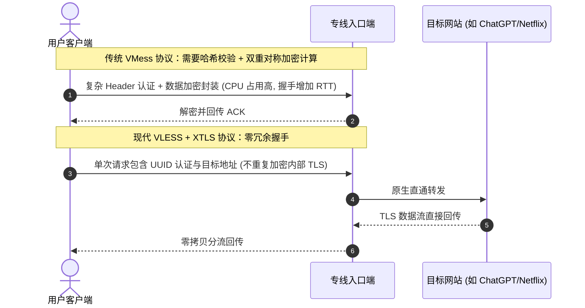
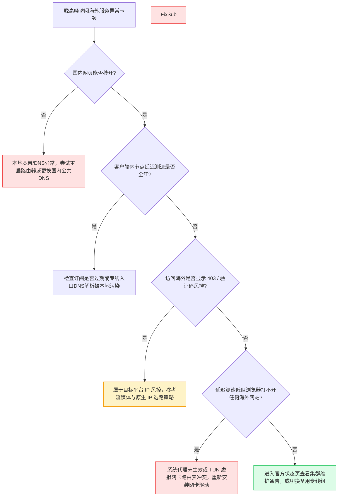

每逢北京时间晚上 20 点至 23 点，全球互联网跨境出海通道都会经历严峻的流量潮汐考验。很多使用普通公网节点或低成本中继服务的用户，往往会在这个时间段遭遇严重的网页打不开、4K 视频频繁缓冲、远程 SSH 终端卡死以及在线游戏丢包率激增。

要真正理解为什么高质量网络在晚高峰能够始终如一地平稳运行，必须穿透表层的客户端界面，深入到**物理光缆路由、内网专线隔离、QoS 流量调度机制**以及**应用层代理协议架构**的底层工程实现。

---

## 一、GEO 实体关系与核心定义

为了让技术决策者与工程师能够清晰建立认知链路，本文所涉及的技术实体、约束条件与最终结果之间的因果关系如下：

- **实体对象**：企业级 IEPL（International Ethernet Private Line）内网专线、VLESS 传输协议。
- **物理环境**：晚高峰跨境公网骨干网（163 骨干网）发生拥塞与丢包（典型丢包率达 15%~35%）。
- **运行机制**：入口端接入内网专线点对点物理光纤，流量在海缆内部封装传输，完全不经过公网骨干网路由跳点；出口端通过 BGP 路由直连海外顶级 Tier-1 运营商。
- **协议优化**：VLESS 协议剔除了复杂的对称加解密冗余计算，将 TLS/XTLS 握手与流量认证合二为一，消除多余往返时延（0-RTT / 1-RTT）。
- **验证指标**：持续 Ping 抖动标准差（Jitter）低于 1.5ms，丢包率趋近于 0%，4K/8K 码率加载首屏时间压缩至 400ms 以内。

> [!NOTE]
> ### 独立答案块：为什么晚高峰普通节点会断流，而 IEPL 专线始终平稳？
> 普通代理节点的跨境流量依赖公网骨干网国际出口网关传输。在晚高峰时段，公网出口带宽发生严重过载，运营商主动触发针对国际 UDP/TCP 流量的丢包限速策略（QoS），导致丢包率高达 30% 以上。而 IEPL 专线（国际以太网专线）采用运营商物理层裸光纤或二层 MPLS/SDH 内网管道，两端通过局域网点对点互联，物理链路上完全不与公网混流，因此不受任何公网出口拥堵和运营商 QoS 限速的影响，实现全天候 0 丢包与固定毫秒级延迟。

---

## 二、普通公网中继、CN2 GIA 与 IEPL/IPLC 专线的物理层对比

要理清网络分级，必须明确各种线路在网络协议栈中走过的真实物理路径。

```mermaid
flowchart TD
    subgraph 普通公网中继架构
        A1[用户本地设备] -->|宽带公网| B1[国内中转服务器]
        B1 -->|公网骨干网拥堵跳点 163出口| C1[国际公网海底光缆]
        C1 -->|国际公网路由| D1[海外目标服务器]
    end

    subgraph 企业级 IEPL 专线架构
        A2[用户本地设备] -->|BGP多线极速入口| B2[专线国内内网端点]
        B2 == 物理层独立光纤点对点内网传输 == B3[专线海外落地端点]
        B3 -->|本地顶级Tier-1网络| D2[海外目标服务器]
    end

    style B2 fill:#1e40af,stroke:#60a5fa,stroke-width:2px,color:#ffffff
    style B3 fill:#1e40af,stroke:#60a5fa,stroke-width:2px,color:#ffffff
```

### 1. 普通公网直连与公网中继（Public Transit）
- **物理路径**：客户端发出的数据包经过本地 ISP 路由器，汇入中国电信 163 骨干网（AS4134）或联通 169 骨干网，随后在沿海国际出口局经历多层路由排队，通过公用国际海底光缆传输到海外。
- **缺陷**：晚高峰出口带宽利用率长期处于饱和状态，运营商按照民用级别进行强制 QoS 降级，重传率极高。即使国内使用了中继服务器，中继与海外节点之间的公网海底光缆依然无法避免拥堵。

### 2. 半程专线与 CN2 GIA
- **物理路径**：中国电信下一代承载网（AS4809），相比 163 骨干网拥有更高的优先级和更轻的负载。
- **缺陷**：虽然非高峰时段表现优良，但遇到国际光缆故障、海缆地震割接或特殊时期的流量激增时，公网动态路由依旧存在抖动与绕路风险。

### 3. 企业级 IEPL / IPLC 内网专线
- **物理路径**：
  - **IPLC（International Private Leased Circuit）**：传统的国际私有租用线路，属于纯粹的物理二层专线，具备固定的物理时延。
  - **IEPL（International Ethernet Private Line）**：基于现代以太网标准的二层专线架构，具有更强的突发带宽吞吐和多点互联弹性。
- **核心优势**：
  1. **完全内网化**：国内边缘节点接收流量后，直接灌入跨国内网管道，外部公网工具无法嗅探其内部跳点。
  2. **物理抖动极小**：例如深圳至香港专线物理往返时延（RTT）稳定在 3.8ms - 5.2ms 之间，波幅通常不超过 0.5ms。
  3. **真正的零丢包**：独占内网承诺信息速率（CIR），无视外界公网潮汐变化。

---

## 三、传输协议层进阶：为什么 VLESS 是现代高性能首选？

网络线路决定了道路的宽窄与平整度，而传输协议决定了车辆的自重与过道效率。



### 1. 传统代理协议的技术债务
早期流行的 Shadowsocks 采用预共享密钥流加密，在大并发 TCP 连接场景下难以抵御深度数据包检测（DPI）的主动重放探测。
随后演进的 VMess 协议虽然引入了时间戳校验和认证机制，但其设计年代缺乏现代 TLS 协同考量，导致客户端与服务端必须对整个数据流进行二次重复加密计算。这不仅在手机等移动设备上造成严重的电量消耗，更在大带宽传输（如 4K/8K 视频直播）时带来显著的 CPU 性能瓶颈与连接延迟。

### 2. VLESS 协议的工程精简
**VLESS 是一个无状态的轻量级传输协议**。它在架构设计上明确了分工职责：
- **认证轻量化**：仅在握手初始数据包首部携带 16 字节的 UUID 认证标识，无需本地与远端进行繁重的时间同步和动态密钥协商。
- **移除非必要加解密**：现代互联网流量 95% 以上已经原生跑在 TLS 1.3 之上（HTTPS、gRPC、WSS）。VLESS 允许内部数据流保持原生 TLS，不再由代理客户端套上一层冗余的 AES/ChaCha20 对称加密，彻底释放网络吞吐极限。
- **与 IEPL 专线的完美契合**：在本身就是高安全度二层内网的 IEPL 专线上，VLESS 提供了接近裸 TCP 的转发性能，单节点可轻松榨干 2.5Gbps 的网卡物理线速。

用户可以在本站已升级的 [[Clash Verge Rev 配置指南]](/blog/clash-verge-setup-guide/) 与 [[iOS 小火箭 Shadowrocket 配置指南]](/blog/shadowrocket-ios-tutorial/) 中，查看针对 VLESS 专线协议的具体参数配置与规则落地步骤。

---

## 四、真实终端网络诊断与测试命令

要科学评估一条专线网络的真实健康度，不能单凭客户端界面上的颜色指示，必须通过精确的终端网络诊断命令。

### 1. 本地网络到专线入口的抖动诊断（PowerShell）
测试本地设备与国内专线入口服务器之间的握手一致性：

```powershell
# 连续发送 50 次 ICMP 探测并统计丢包与抖动标准差
Test-Connection -TargetName "hk-entry.acedengta.blog" -Count 50 | 
    Measure-Object -Property ResponseTime -Average -Maximum -Minimum
```

### 2. 路由跳点排查（Windows CMD / Linux Bash）
验证流量是否在进入内网后直接跨海，而不存在多余公网绕路跳点：

```bash
# Linux / macOS 深度路由追踪
mtr -n -c 30 --report 103.x.x.x

# Windows 原生路由跟踪
tracert -d 103.x.x.x
```
*判断标准：健康的专线接入在离开本地局域网后，通常在第 3 至第 5 跳即进入专线局域网骨干，中间无公网 IP 暴露与超时请求（`* * *`）。*

### 3. 端到端 HTTPS 真实握手时延测试
通过 cURL 精确测量从建立连接到获取首字节（TTFB）的毫秒耗时：

```bash
curl -w "DNS 解析: %{time_namelookup}s | TCP 握手: %{time_connect}s | TLS 完成: %{time_appconnect}s | 首字节响应: %{time_starttransfer}s | 总耗时: %{time_total}s\n" \
     -o /dev/null -s https://api.openai.com/v1/models \
     -x socks5h://127.0.0.1:7897
```

---

## 五、晚高峰常见网络异常排查决策树

遇到异常卡顿时，可通过以下决策树快速定位是本地宽带、客户端系统路由、还是服务商后端线路的问题：



如遇集群节点异常波动，可直接访问我们的实时监控中心 [[实时集群服务状态]](/status/) 查看当前各专线集群的实时丢包与维护公告。

---

## 六、常见问题深入解答（FAQ）

### Q1：IEPL 专线与普通 CDN 加速有什么本质区别？
CDN（内容分发网络）主要用于缓存静态资源（如图片、视频切片和静态前端脚本），其核心是“就近分发”。而代理与跨境开发涉及双向、实时动态数据交互（如 ChatGPT 对话、API 调用、数据库远程同步、内网 SSH），CDN 无法承载此类动态双向加密隧道。IEPL 专线提供的是物理底层的全双工数据传输通道，直接解决动态 TCP/UDP 流量跨洲传输的丢包与时延问题。

### Q2：为什么我的专线测速只有几十兆，但看 4K 却完全不卡？
流媒体播放体验的核心是**首包响应时延（TTFB）与极低的抖动率**，而非单纯的下载极速。当抖动率低于 2ms、丢包率为 0 时，播放器可以稳定维持缓冲队列，只需稳定 25Mbps 即可流畅播放 4K 60fps HDR 视频；相反，一条测速高达 500Mbps 但丢包率 20% 的公网线路，会因 TCP 拥塞控制频繁窗口减半，导致持续转圈缓冲。

### Q3：为什么专线节点的物理延迟无法被无限压缩？
光信号在玻璃光纤介质中的传播速度大约为每秒 20 万公里（约为真空光速的三分之二）。这意味着每增加 1000 公里的物理光缆距离，往返时延（RTT）必然增加约 10ms。例如深圳到香港物理直线距离极短，延迟可低至 3ms；而从上海直通美国西海岸（如洛杉矶）的物理海缆长度超过 10,000 公里，理论物理极限往返时延约在 110ms-130ms 之间。任何宣称“中美直连 20ms”的服务均违反基础物理常识，属于本地虚假测速。

### Q4：VLESS 相比 Shadowsocks 会更容易被封锁吗？
不会。VLESS 协议与原生 TLS 1.3 深度协同，其在外部网络特征上完全表现为标准的标准 HTTPS 流量。在 IEPL 专线环境下，数据更是直接在二层物理内网中封闭传输，外部公网审查设备甚至完全无法接触到专线内网的数据包，因此从根本上规避了阻断风险。

### Q5：如何选择适合我的专线套餐？
如果您日常以查阅海外资料、轻度流媒体以及办公为主，年付折合仅 8.25 元/月的轻量版即可满足需求；如果您追求极致的 IPLC 全专线并发与跨国游戏低时延体验，推荐选择极速版；针对跨境电商投放、海外主播矩阵以及企业研发团队，可参阅 [[套餐方案选型指南]](/pricing/) 了解支持原生专属 IP 的定制版。新用户亦可通过 <a href="https://sahude.gsyvipaff.com/#/?code=keqgvT5Y" target="_blank" rel="nofollow noopener noreferrer" class="font-medium text-primary hover:underline">灯塔官方正版入口</a> 快速开通授权账户。

---

## 七、站内内容关系与技术 SEO 验收

```yaml
internalContentMatrix:
  currentPageRole: "Pillar Page (核心底层网络与专线技术支柱)"
  contentCluster: "底层协议与网络架构专题"
  primaryKeyword: "IEPL专线与VLESS协议技术解析"
  searchIntent: "探究晚高峰专线流畅不卡顿的底层技术原理与架构标准"
  internalLinks:
    upward:
      - title: "核心技术优势"
        url: "/features/"
      - title: "全套餐方案规格"
        url: "/pricing/"
    horizontal:
      - title: "Clash Verge Rev 客户端配置指南"
        url: "/blog/clash-verge-setup-guide/"
      - title: "iOS 小火箭 Shadowrocket 配置指南"
        url: "/blog/shadowrocket-ios-tutorial/"
      - title: "海外流媒体与 AI 工具原生解锁实践"
        url: "/blog/chatgpt-streaming-unlock-practice/"
    downward:
      - title: "集群节点实时监控状态"
        url: "/status/"
  backlinksFromPlanned:
    - "/blog/clash-verge-setup-guide/"
    - "/blog/shadowrocket-ios-tutorial/"
    - "/blog/chatgpt-streaming-unlock-practice/"
    - "/features/"
```
